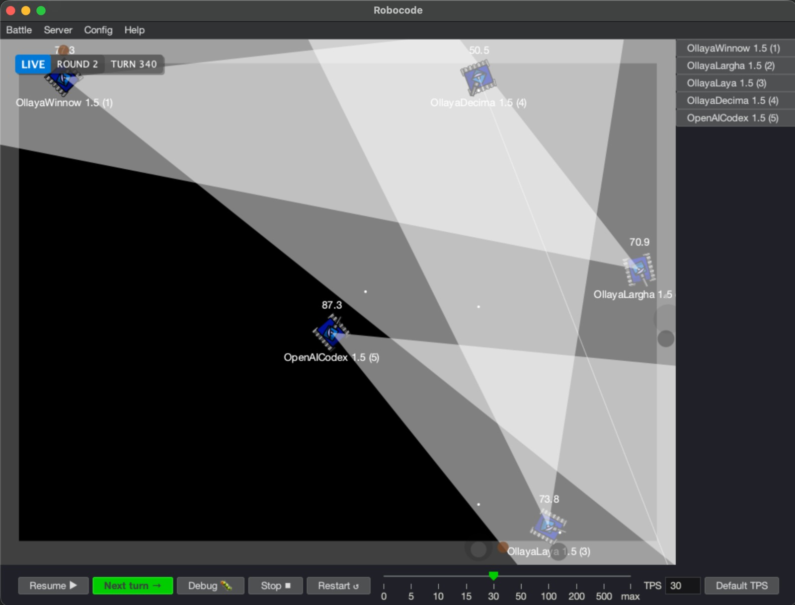

# Tank Royale + Ollaya

Feasibility test: [Robocode Tank Royale](https://robocode.sourceforge.io/)
bots driven by [Ollaya](https://github.com/instilabs/ollaya) local LLMs through
the systemone API. Part of the Instinct labs demo for whatevergeek's Nov 24 talk.




## What's here

| Path | What |
| --- | --- |
| `OllayaDecima/` | local bot driven by `decima:small` |
| `OllayaLargha/` | local bot driven by `largha` |
| `OllayaLaya/` | local bot driven by `laya:en` |
| `OllayaWinnow/` | local bot driven by `winnow:e4b` |
| `OpenAICodex/` | bot driven by any OpenAI-compatible `/chat/completions` endpoint (defaults to a local bridge at `127.0.0.1:8787`) |
| `RunBattle.java` | one-shot classic 3-round battle between two bots |
| `tournament/` | round-robin + melee kit, plus opt-in cloud bots (see `tournament/README.md`). v1.5 brain architectures: **s1** (fast decision model), **s2 / OllayaReasoner** (one reasoning model, blocking), **twotier / OllayaTwoTier** (background S2 strategist + fast local S1 tactician) |

## The four bots (all local)

All four bot folders at the repo root run against the **local ollaya daemon**
(`127.0.0.1:11435`) - no API keys, no cloud. They share identical code and
prompts from `tournament/template.py`; only the model name differs. Cloud
variants (OllayaCloud / OllayaReasoner / OllayaTwoTier) are opt-in via
`sh tournament/make_bots.sh --with-cloud` and need `OPENROUTER_API_KEY`.

## OpenAICodex (OpenAI-compatible endpoint)

`OpenAICodex/` plays the same aggressive / evasive / probe game, but each
decision is a Chat Completions call to any OpenAI-compatible endpoint. By
default it targets a local bridge at `http://127.0.0.1:8787/v1` with model
`codex-local`; no API key is needed unless the endpoint asks for one.

Configuration is by environment variable:

| Variable | Default | What |
| --- | --- | --- |
| `OPENAI_BASE_URL` | `http://127.0.0.1:8787/v1` | endpoint root |
| `OPENAI_CHAT_URL` | `<base>/chat/completions` | full URL override |
| `OPENAI_API_KEY` | empty | sent as a `Bearer` token only when set |
| `OPENAI_MODEL` | `codex-local` | model name in the request |
| `OPENAI_TIMEOUT_S` | `30` | per-decision timeout (seconds) |
| `OPENAI_MIN_INTERVAL_S` | `0` | minimum seconds between calls (0 = every 40 ticks) |

On error or timeout the bot falls back to **hesitate**, same as the local
bots. Its launcher uses the repo-root `.venv` like the other bots.

## Loading the bots in the Tank Royale GUI

1. Start ollaya and pull the four models:
   `ollaya pull decima:small largha laya:en winnow:e4b` (winnow:e4b needs ~8GB RAM).
2. In the GUI, open **Setup > Bot Root Directories** (the folder picker for
   bot directories) and add the repo root folder (the one containing
   `OllayaDecima/`, `OllayaLargha/`, `OllayaLaya/`, `OllayaWinnow/`).
   Alternatively add each of the four bot folders individually.
3. The four bots appear in the bot list - select any of them for a battle.

Each bot folder carries its own `.json` (bot manifest), `.py` (the bot) and
`.sh` (launcher) - everything the GUI/runner needs.

## v1.3 behavior notes

Both bots run identical code from one template; only the model differs. Every
40 ticks the bot asks its model for one of three modes:

- **aggressive** - hunt and fire
- **evasive** - dodge-and-counter (closes at an angle, still attacking)
- **probe** - sweeping search pattern

The decision call is blocking (5s timeout): while the model thinks, the bot
coasts on its last orders, so slow models visibly lose control authority. On
error or timeout the bot falls back to **hesitate** (v1.2's aggressive
fallback was removed so an equalizer can't mask model differences). The model
is the differentiator: decision speed and accuracy decide the battle.

Every decision logs one line to bot stderr:

```
DECIDE[OllayaDecima] model=decima:small result=aggressive energy=80 ms=172
```

## Running

Requires: JDK 25+, Python 3 with `robocode-tank-royale`, Ollaya serving on
`127.0.0.1:11435` with `decima:small` and `largha` pulled, and
`robocode-tankroyale-runner-1.4.0.jar`.

```sh
java -cp robocode-tankroyale-runner-1.4.0.jar RunBattle.java
```
